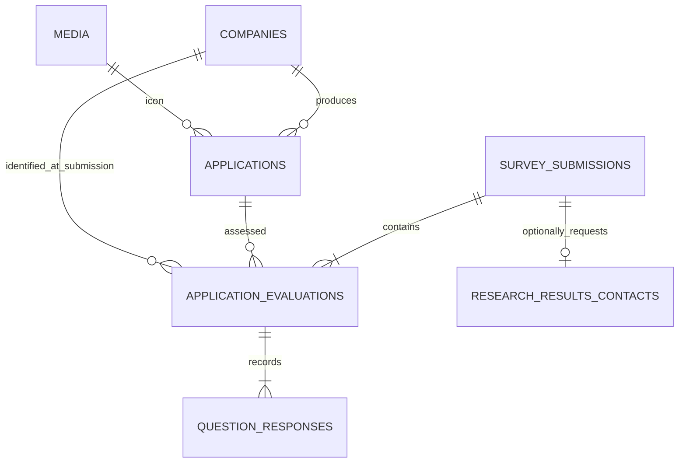

# Data model and integrity

Payload generates PostgreSQL tables and relationships from the collection definitions. Generated TypeScript is in `src/payload-types.ts`; migrations are the authoritative deployment history. Integer database IDs are internal and never exposed on public confirmation pages. UUID submission identifiers appear only in authenticated research exports/admin.

## Collections and global

| Entity                    | Contents                                                                                                                                   | Access                                                                                    |
| ------------------------- | ------------------------------------------------------------------------------------------------------------------------------------------ | ----------------------------------------------------------------------------------------- |
| Admin Users               | Payload auth, email, display name, lockout/token data                                                                                      | Authenticated administrators; initial creation requires trusted CLI context               |
| Companies                 | Name, website, description, participation status, interview agreement/progress, private notes                                              | Admin only; API deletion disabled                                                         |
| Applications              | Name, required uploaded icon, company relation, URL, category, active/public flags, order                                                  | Admin only; API deletion disabled                                                         |
| General Questions         | Independent general instrument question definitions                                                                                        | Admin only                                                                                |
| Detailed Questions        | Independent detailed instrument question definitions                                                                                       | Admin only                                                                                |
| Media                     | Raster application icons and alternative text                                                                                              | Public read, admin writes                                                                 |
| Survey Submissions        | Unique UUID, request hash, optional name/profile, background class, mode, instrument version, consent version/time, exact session snapshot | Admin read; trusted survey service creates; API mutation/deletion denied                  |
| Application Evaluations   | Submission, application/company relations and name snapshots, mode, instrument version, question count, timestamps                         | Same immutable policy                                                                     |
| Question Responses        | Evaluation relation, stable question ID, question text/version/dimension/required/scoring snapshot, response status and raw rating         | Same immutable policy                                                                     |
| Research Results Contacts | Optional results-request email, restricted submission link for deletion, subscription time                                                 | Admin read; trusted survey service creates; excluded from analytical export configuration |
| Research Settings global  | Title, description, introduction, consent/version, contact, availability, closing message                                                  | Admin only; safe public projection rendered on server                                     |

The import/export plugin also registers its maintenance collections. Their access is restricted to administrators, and saving/queueing/importing data is disabled for enabled research collections.

## Relationships



Question responses intentionally do not depend on live question-document relations. Deleting or editing a live question cannot erase or reinterpret its historical text or scoring metadata. Application/company IDs and names are fixed at submission; later application reassignment does not move old evaluations to another company.

## Participant classification and identity

`background` is exactly `ui-ux`, `software`, or `other`. Specialist status takes precedence and clears the secondary software-related flag. Profile URLs are accepted only for specialists and must use HTTP(S). First/surname are independent optional trimmed fields. Results requests are separate from required participation consent; an email is validated only when subscription is enabled and otherwise discarded.

Names/profile URLs live in restricted submissions. Emails live in a separate restricted contact collection, linked only to support administrative deletion; they are not part of analytical exports. Database operators and authorized administrators can still associate these records. This is separation and access restriction, not irreversible anonymization. Encrypt database and backups at the infrastructure layer and define retention before deployment.

## Questionnaire versioning

Every question has a stable string ID that is unique within its collection and immutable after creation. General/detailed namespaces are independent. Every edit increments its numeric version on the server, ignoring a supplied replacement version. Questions support text, description, order, required/active, dimension, reverse scoring, and NA permission.

A server creates a complete immutable session snapshot and signs it. The session carries the full consent text/version/contact and exact question definitions, including order and the scale endpoints. Its SHA-256 analytical version covers only mode, ordered questions, and scale, so unrelated enrollment changes do not fragment analysis. A mode has no shared instrument identity with the other mode even if its wording happens to match.

Snapshots are not a browsable public CMS collection. They travel as authenticated signed content, are validated on the server, and become immutable JSON on the submission. Answer rows additionally copy each question's historical fields. Signed snapshots expire after 24 hours. Questions can change during a session without changing that participant's instrument. Current application eligibility and survey availability are checked again at persistence time.

## Answers

Each evaluated application produces one row per snapshot question, including an unanswered row for omitted optional questions. `status` is `rated`, `not-applicable`, or `unanswered`. `rating` is an integer 1–7 only for `rated`, and null for the other statuses. Required questions must have a numerical answer or explicitly permitted NA. Zero is never used as a missing value. A reverse-scored raw rating stays unchanged; derived scores use `8 - rating` only in analysis.

Each selected application is unique within a validated submission. Its question set is fixed by the snapshot, and there are no application-specific overrides. Relational records and email contacts commit in a single serializable transaction. Request UUID uniqueness plus a request-content hash prevents duplicate inserts and conflicting reuse. Timestamps use server UTC, including acknowledgment of consent at final submission; the browser is not authoritative for time.

## Abuse bookkeeping

`survey_rate_limits` is a small SQL-only table with `bucket`, `window_start`, and `count`. A bucket is an HMAC of a trusted proxy IP or a shared installation key. An atomic upsert counts attempts in ten-minute windows; records older than the previous window are removed on subsequent traffic. Raw IPs are not saved. This table has a dedicated migration and is not research data. Backups may contain hashed bookkeeping; apply the same protection as other operational metadata.

## Retention and deletion

Choose institutional retention and withdrawal rules before launching. Anonymous participation without a recovery token generally cannot be reliably located later. Explain that limitation in consent; do not promise withdrawal that cannot be fulfilled. Optional names are not reliable unique identifiers either.

Ordinary API mutation of research records is blocked to avoid accidental corruption. A trusted operator can perform an approved deletion inside a database transaction after locating the correct internal submission ID. The following parameterized SQL illustrates the exact dependency order; supply `$1` through a database client's parameter binding, never string-interpolate a participant value:

```sql
BEGIN;
DELETE FROM question_responses
WHERE evaluation_id IN (
  SELECT id FROM application_evaluations WHERE submission_id = $1
);
DELETE FROM research_results_contacts WHERE submission_id = $1;
DELETE FROM application_evaluations WHERE submission_id = $1;
DELETE FROM survey_submissions WHERE id = $1;
COMMIT;
```

Also remove any approved cached/exported copies under your institution's policy. Database backups retain old copies until backup expiry; document that schedule. Take a protected backup before a manual change and verify that the selected submission is correct. This operation is intentionally not exposed as a public deletion endpoint.
